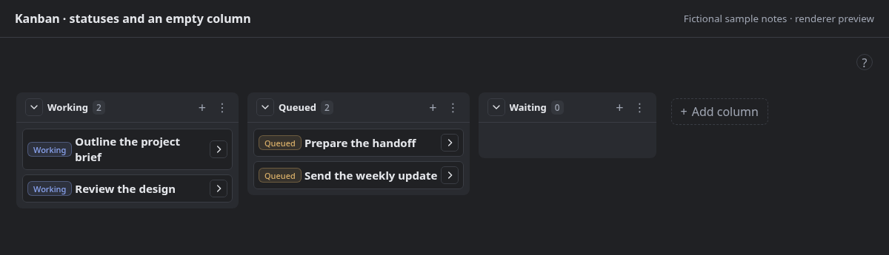
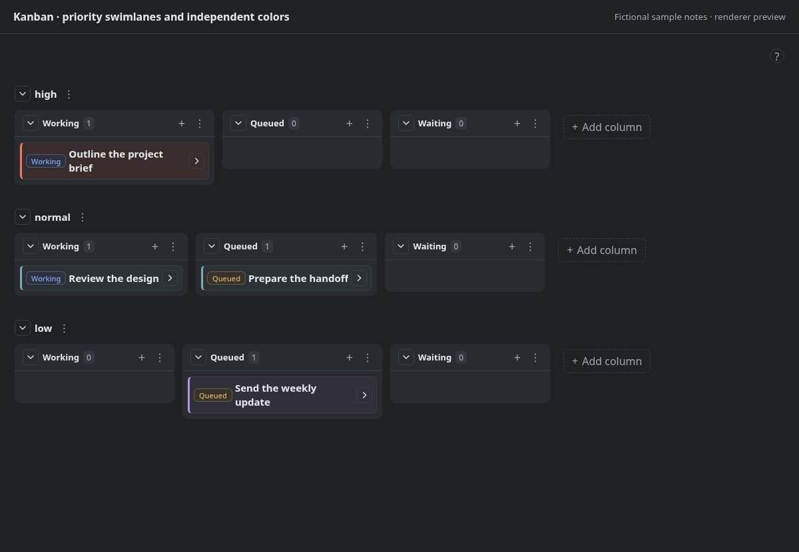
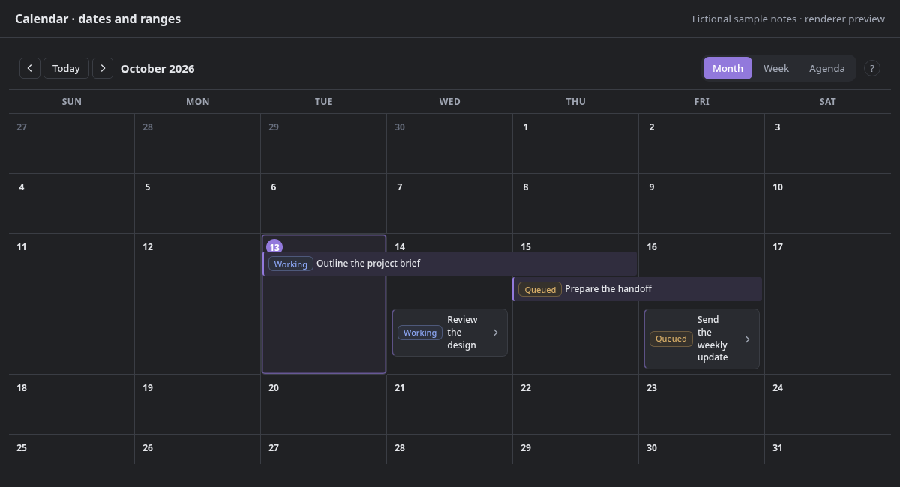
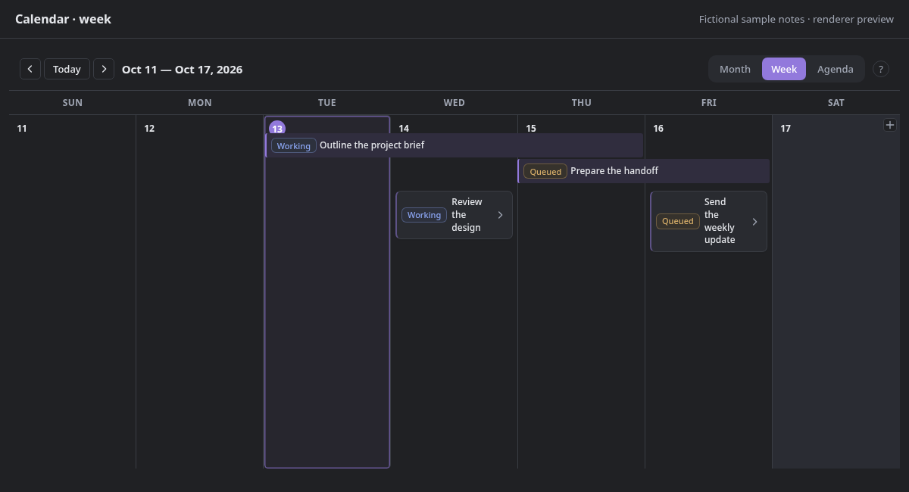
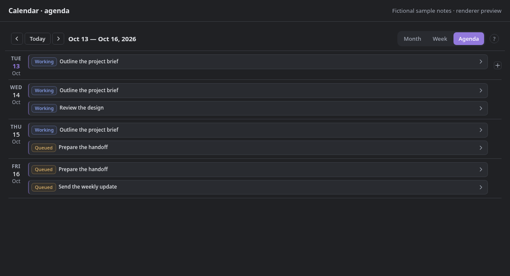
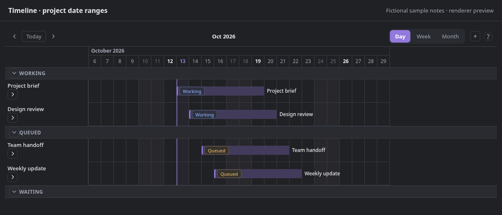
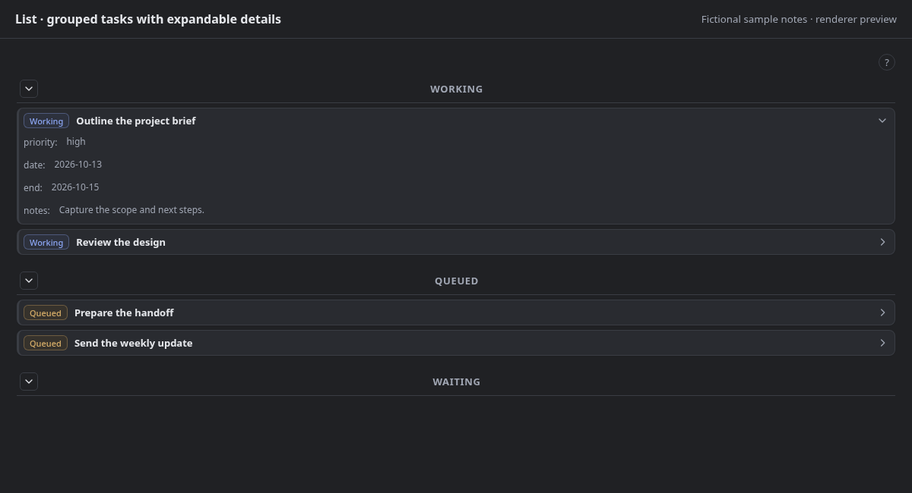
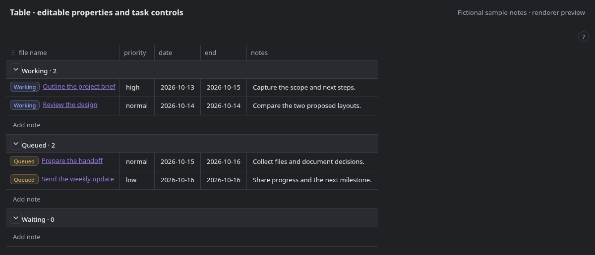

# WCC Base Views

Extra views for the specific Obsidian Bases that need a more hands-on workflow: planning dates, moving tasks, changing statuses, and editing note properties in place.

**Use native Obsidian views wherever they meet your needs.** WCC Base Views is intended to fill particular gaps, not replace Bases or become the default for every database. You can mix native and WCC views in the same Base. Both work with the same Markdown notes and properties; WCC uses Bases’ existing filters, formulas, grouping, and property selection.



_Preview generated from the current plugin renderer with fictional notes and an Obsidian API adapter. It is not a capture of the Obsidian application. The gallery below shows all five layouts and all three task-control modes; your theme and selected properties will change their appearance._

## Why use a WCC view?

Choose it for a workflow you actually need—not simply because it has a different layout name.

| Your Base needs…                                                      | Consider…                                                                                                  |
| --------------------------------------------------------------------- | ---------------------------------------------------------------------------------------------------------- |
| Scheduling notes on dates, moving events, or working with date ranges | **Calendar:** Month, Week, and Agenda layouts, date/range creation, and drag-to-reschedule.                |
| Planning durations and adjusting a project’s start/end dates          | **Timeline:** inclusive date ranges, movable bars, resize handles, and details that adapt to narrow panes. |
| A task list with visible controls and just enough detail              | **List:** Checkbox, Status, or None; colored controls; expandable properties; and saved drag order.        |
| A board with status controls, swimlanes, and per-value colors         | **Kanban:** editable status pills, optional swimlanes, column/card colors, and persistent empty columns.   |
| A property-editing view that participates in the same task workflow   | **Table:** colored status controls, drag ordering within/between groups, and content-based column sizing.  |

Native Obsidian already offers powerful [Bases layouts](https://obsidian.md/help/bases/views), including [Kanban in Obsidian 1.14+](https://obsidian.md/help/bases/views/kanban). Column dragging, note creation, grouping, and image covers alone are not reasons to prefer this plugin. Compare the particular interactions you need in your installed version. For example, the native [Table view](https://obsidian.md/help/bases/views/table) provides summaries and cell-selection shortcuts; WCC Table does not attempt to reproduce every native Table feature.

### Filling gaps, and eventual deprecation

The goal is more robust features on the Bases that need them, while leaving ordinary browsing and editing to native views whenever possible.

If native Obsidian reaches feature parity for a particular view’s intended workflows, I’ll likely deprecate that WCC view. I’ll assess that per view rather than treating this plugin as an all-or-nothing replacement. The intention is to explain any deprecation and how to switch to the native view, while keeping your notes and properties usable. No view is being deprecated by this update.

## Preview the views

These previews show the current source, not necessarily the latest published release. Expand a layout to see it at full width.

<details>
<summary>Kanban extras — swimlanes and independent card/control colors</summary>



This example uses priority for swimlanes and card colors, while pills are colored by status. The grouping and color properties are your choice. Covers and custom card titles are optional too.

</details>

<details>
<summary>Calendar — Month, Week, and Agenda scheduling</summary>



Month preview. Calendar events stay flat: pill, name, and optional details. Week and Agenda are selectable from the toolbar. A narrow pane uses a date selector and a selected-day event list.





[See the narrow-pane Calendar preview](docs/screenshots/calendar-narrow.png).

</details>

<details>
<summary>Timeline — date ranges and resize handles</summary>



Move bars to change dates; drag their edges to change a range. Day, Week, and Month zoom are available. Date dragging changes dates, not manual row order.

</details>

<details>
<summary>List — grouped tasks and expandable properties</summary>



Use Compact or Comfortable spacing, hide empty properties, and expand details on individual tasks. Group arrows collapse entire sections.

</details>

<details>
<summary>Table — properties, status controls, and automatic column widths</summary>



Choose columns through the native Properties menu. Drag headers to reorder, resize dividers, or double-click a divider to return that column to automatic sizing.

</details>

### Three task-control modes

The same choice is available in every WCC view, including Kanban.

| Mode         | Example                                                                                       | Behavior                                                                              |
| ------------ | --------------------------------------------------------------------------------------------- | ------------------------------------------------------------------------------------- |
| **Checkbox** |                      | Uses your selected checkbox property, such as `done`.                                 |
| **Status**   |                | Click the pill to choose another status. No status automatically counts as completed. |
| **None**     |  | Hides the task checkbox and status pill, without changing stored values.              |

An unset task-control mode defaults to Checkbox, but a Base without a configured checkbox property does not gain an implicit completion field.

## Get started

1. Enable the **Bases** core plugin and create or open a Base.
2. Add a view and choose **WCC - Calendar**, **WCC - List**, **WCC - Kanban**, **WCC - Timeline**, or **WCC - Table**.
3. Use the native **Filter**, **Group**, **Sort**, and **Properties** controls for the notes and fields you want to see.
4. In **Setup**, choose the task-control mode and its property. For Calendar/Timeline, also choose a date property; end date is optional.
5. Use **Appearance** for everyday display choices, **Advanced** for optional overrides, and the view’s **?** button for explanations and examples.

Property names can be existing or new. Enter names such as `date`, `done`, or `status`; selecting a name does not modify your notes. Calendar and Timeline need a valid start date to show a note.

A note might contain:

```yaml
---
date: 2026-10-13
end: 2026-10-15
status: Working
done: false
priority: high
---
```

Its filename supplies its title. These names are examples, not a required task schema. Try the complete [five-view sample](sample_docs/some-fixes/Start%20here.md) by copying the contents of `sample_docs/some-fixes/` into a `Some fixes` folder at your vault root.

### Statuses, colors, and ordering

- **No default statuses:** pills offer values found in your Base’s notes plus the values you add in settings. **Keep empty statuses** keeps additional groups visible when grouping by the selected status property. Calendar calls this **Extra status choices**, since it does not show status group headings. Settings are per view.
- **Empty Kanban columns:** columns stay after their last task leaves. **Add column** creates a column without creating a placeholder note. Column menus hide groups; **Manage hidden groups** restores them.
- **Independent colors:** **Appearance → Color cards by** colors items. **Advanced → Color task controls by** colors checkboxes and status pills, with rules such as `high:red` or `Working:#8b5cf6`. Existing checkbox-color mappings are reused. Linked values accept short-name rules such as `Work:orange`.
- **Automatic manual order:** a real task reorder in List, Table, Kanban, or Calendar selects `order` if no manual-order property is configured, then writes numeric ranks. If that name contains nonnumeric values in the Base, it uses a suffixed name such as `order_2`. **Advanced → Manual order property** lets you choose a different numeric property. A drop that changes nothing creates no mapping.
- **Automatic spacing:** Compact uses 3px inside cards; Comfortable, Kanban, and Timeline use 6px. Custom padding is retired and old values are ignored.

Status changes do not update `done`, and completion alone does not remove a note. Use a native Base filter if you want completed tasks hidden. New-note buttons use Bases’ own creation settings and supply the selected date or writable group value.

## Installation

Requires **Obsidian 1.10.2 or later** and the **Bases** core plugin. Desktop and mobile are supported; Dataview is not required.

For manual installation:

1. Download `main.js`, `manifest.json`, and `styles.css` from the [release you want to use](https://github.com/wcchristian/obsidian-wcc-base-views/releases).
2. Place them in your vault’s `.obsidian/plugins/wcc-base-views/` folder.
3. Reload Obsidian and enable **WCC Base Views** in **Settings → Community plugins**.

This README follows the current source. Check the release notes for what is included in a published version; unreleased source changes may not be in the latest release yet. See [Contributing](CONTRIBUTING.md) to build the source or test an unreleased branch. Individual views can be disabled in the plugin settings.

## Your data and existing Bases

Notes remain ordinary Markdown files. There is no automatic task-frontmatter migration or synchronization between status and completion. Direct edits, task-control clicks, and drag operations write the relevant note properties; the first reorder can also configure and populate the manual-order property. File and formula properties are read-only.

Existing property mappings are retained. Intentional changes in the current source include flat Calendar events, persistent empty Kanban columns, saved Calendar layout/Timeline zoom selections, automatic manual ordering, and retired custom padding. See the [migration notes](docs/migration.md) before updating older setups.

The plugin does not collect telemetry or require an account. Optional remote background/cover images load from their hosts; vault images can be used instead.

## Help and development

- [View behavior and configuration](docs/views.md)
- [Migration notes](docs/migration.md)
- [Development, testing, and releases](CONTRIBUTING.md)
- [Report a bug or request a workflow improvement](https://github.com/wcchristian/obsidian-wcc-base-views/issues)

Under active development. Licensed under [MIT](LICENSE).
